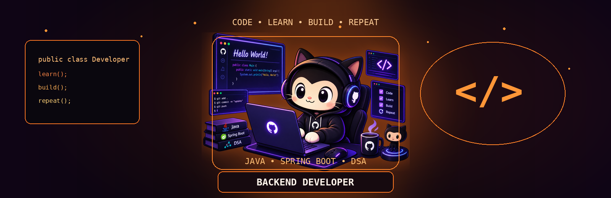

# Hi, I'm Priyanshu

  

I enjoy solving problems and building projects. Currently working with Java and Spring Boot for backend development, while also practicing DSA and working with Python and SQL.

## What I'm Working With

- **Languages:** Java, Python, SQL
- **Backend:** Spring Boot, REST APIs
- **Database:** MySQL
- **Tools:** Git, GitHub

## Tech Stack

## GitHub Stats

  
  

## DSA Practice

I maintain a separate repository for the DSA problems I solve and the concepts I practice.

[DSA-PRACTICE](https://github.com/priyanshuu-dev/DSA-PRACTICE)

## Connect

[GitHub](https://github.com/priyanshuu-dev) · [LinkedIn](https://linkedin.com/in/priyanshu-raj-b44129309) · [LeetCode](https://leetcode.com/priyanshuusinghh) · [Email](mailto:rajrthp123@gmail.com)
